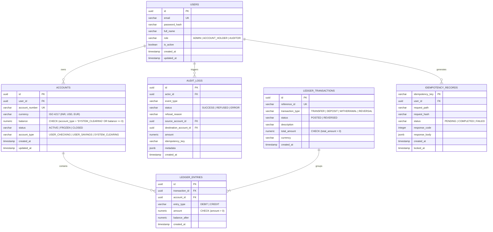

# LedgerLine Database Schema Specification

## 1. Accounting Philosophy & Core Constraints

LedgerLine implements a strict **double-entry, append-only financial ledger** on top of PostgreSQL.

### Financial Invariants
1. **The Double-Entry Equation**:
   Every transfer transaction consists of a header in `ledger_transactions` and at least two balancing entries in `ledger_entries` (one DEBIT and one CREDIT).
   $$\sum \text{Debits} = \sum \text{Credits}$$
2. **Money Conservation**:
   Internal transfers do not create or destroy money. For external money movements (deposits and withdrawals), balanced entries are posted between the user's account and the internal `SYSTEM_CLEARING` account.
3. **Non-Negative User Balances**:
   Every user account balance must satisfy:
   $$\text{balance} \ge 0$$
   This is enforced by an explicit SQL `CHECK` constraint and verified atomically inside row-locked transactions.
4. **Append-Only Immutability**:
   Financial ledger records in `ledger_entries` are write-only. Database triggers prevent `UPDATE` and `DELETE` operations. Reversals are performed via explicit compensating entries.
5. **Exact Numeric Representation**:
   All monetary amounts use PostgreSQL `NUMERIC(18, 4)`. Floating-point numbers (`FLOAT`, `DOUBLE PRECISION`, `REAL`) are strictly prohibited to prevent IEEE-754 precision loss.

---

## 2. Entity-Relationship Diagram



---

## 3. Table Definitions & DDL

### 3.1 `users`
Stores authenticated actors and their assigned role.
```sql
CREATE TABLE users (
    id UUID PRIMARY KEY DEFAULT gen_random_uuid(),
    email VARCHAR(255) NOT NULL,
    password_hash VARCHAR(255) NOT NULL,
    full_name VARCHAR(150) NOT NULL,
    role VARCHAR(50) NOT NULL CHECK (role IN ('ADMIN', 'ACCOUNT_HOLDER', 'AUDITOR')),
    is_active BOOLEAN NOT NULL DEFAULT TRUE,
    created_at TIMESTAMPTZ NOT NULL DEFAULT CURRENT_TIMESTAMP,
    updated_at TIMESTAMPTZ NOT NULL DEFAULT CURRENT_TIMESTAMP
);

CREATE UNIQUE INDEX uq_users_email_lower ON users (LOWER(email));
CREATE INDEX idx_users_role ON users (role);
```

### 3.2 `accounts`
Stores individual monetary accounts.
```sql
CREATE TABLE accounts (
    id UUID PRIMARY KEY DEFAULT gen_random_uuid(),
    user_id UUID NOT NULL REFERENCES users(id) ON DELETE RESTRICT,
    account_number VARCHAR(32) NOT NULL UNIQUE,
    currency VARCHAR(3) NOT NULL DEFAULT 'INR',
    balance NUMERIC(18, 4) NOT NULL DEFAULT 0.0000,
    status VARCHAR(20) NOT NULL DEFAULT 'ACTIVE' CHECK (status IN ('ACTIVE', 'FROZEN', 'CLOSED')),
    account_type VARCHAR(30) NOT NULL DEFAULT 'USER_CHECKING' CHECK (account_type IN ('USER_CHECKING', 'USER_SAVINGS', 'SYSTEM_CLEARING')),
    created_at TIMESTAMPTZ NOT NULL DEFAULT CURRENT_TIMESTAMP,
    updated_at TIMESTAMPTZ NOT NULL DEFAULT CURRENT_TIMESTAMP,
    CONSTRAINT chk_accounts_balance_positive CHECK (account_type = 'SYSTEM_CLEARING' OR balance >= 0)
);

CREATE INDEX idx_accounts_user_id ON accounts (user_id);
CREATE INDEX idx_accounts_status ON accounts (status);
```

### 3.3 `ledger_transactions`
The journal header representing a business event (transfer, deposit, withdrawal).
```sql
CREATE TABLE ledger_transactions (
    id UUID PRIMARY KEY DEFAULT gen_random_uuid(),
    reference_id VARCHAR(64) NOT NULL UNIQUE,
    transaction_type VARCHAR(20) NOT NULL CHECK (transaction_type IN ('TRANSFER', 'DEPOSIT', 'WITHDRAWAL', 'REVERSAL')),
    status VARCHAR(20) NOT NULL DEFAULT 'POSTED' CHECK (status IN ('POSTED', 'REVERSED')),
    description TEXT,
    total_amount NUMERIC(18, 4) NOT NULL CHECK (total_amount > 0),
    currency VARCHAR(3) NOT NULL DEFAULT 'INR',
    created_at TIMESTAMPTZ NOT NULL DEFAULT CURRENT_TIMESTAMP
);

CREATE INDEX idx_ledger_tx_created ON ledger_transactions (created_at DESC);
CREATE INDEX idx_ledger_tx_type ON ledger_transactions (transaction_type);
```

### 3.4 `ledger_entries`
The immutable double-entry line items.
```sql
CREATE TABLE ledger_entries (
    id UUID PRIMARY KEY DEFAULT gen_random_uuid(),
    transaction_id UUID NOT NULL REFERENCES ledger_transactions(id) ON DELETE RESTRICT,
    account_id UUID NOT NULL REFERENCES accounts(id) ON DELETE RESTRICT,
    entry_type VARCHAR(10) NOT NULL CHECK (entry_type IN ('DEBIT', 'CREDIT')),
    amount NUMERIC(18, 4) NOT NULL CHECK (amount > 0),
    balance_after NUMERIC(18, 4) NOT NULL,
    created_at TIMESTAMPTZ NOT NULL DEFAULT CURRENT_TIMESTAMP
);

CREATE INDEX idx_ledger_entries_account_created ON ledger_entries (account_id, created_at DESC);
CREATE INDEX idx_ledger_entries_tx_id ON ledger_entries (transaction_id);

-- Enforce Immutability Trigger
CREATE OR REPLACE FUNCTION trg_fn_prevent_ledger_tampering()
RETURNS TRIGGER AS $$
BEGIN
    RAISE EXCEPTION 'Ledger entries are strictly immutable. UPDATE and DELETE operations are forbidden.';
END;
$$ LANGUAGE plpgsql;

CREATE TRIGGER trg_ledger_entries_immutability
BEFORE UPDATE OR DELETE ON ledger_entries
FOR EACH ROW EXECUTE FUNCTION trg_fn_prevent_ledger_tampering();
```

### 3.5 `idempotency_records`
Prevents duplicate financial executions from repeated or retried API requests.
```sql
CREATE TABLE idempotency_records (
    idempotency_key VARCHAR(128) PRIMARY KEY,
    user_id UUID NOT NULL REFERENCES users(id) ON DELETE CASCADE,
    request_path VARCHAR(255) NOT NULL,
    request_hash VARCHAR(64) NOT NULL,
    status VARCHAR(20) NOT NULL CHECK (status IN ('PENDING', 'COMPLETED', 'FAILED')),
    response_code INTEGER,
    response_body JSONB,
    created_at TIMESTAMPTZ NOT NULL DEFAULT CURRENT_TIMESTAMP,
    locked_at TIMESTAMPTZ NOT NULL DEFAULT CURRENT_TIMESTAMP
);

CREATE INDEX idx_idemp_user ON idempotency_records (user_id);
CREATE INDEX idx_idemp_created ON idempotency_records (created_at);
```

### 3.6 `audit_logs`
Append-only log of all security, financial, and refused transaction events.
```sql
CREATE TABLE audit_logs (
    id UUID PRIMARY KEY DEFAULT gen_random_uuid(),
    actor_id UUID REFERENCES users(id) ON DELETE SET NULL,
    event_type VARCHAR(50) NOT NULL,
    status VARCHAR(20) NOT NULL CHECK (status IN ('SUCCESS', 'REFUSED', 'ERROR')),
    refusal_reason VARCHAR(100),
    source_account_id UUID REFERENCES accounts(id) ON DELETE SET NULL,
    destination_account_id UUID REFERENCES accounts(id) ON DELETE SET NULL,
    amount NUMERIC(18, 4),
    idempotency_key VARCHAR(128),
    metadata JSONB,
    created_at TIMESTAMPTZ NOT NULL DEFAULT CURRENT_TIMESTAMP
);

CREATE INDEX idx_audit_created ON audit_logs (created_at DESC);
CREATE INDEX idx_audit_actor ON audit_logs (actor_id);
CREATE INDEX idx_audit_event ON audit_logs (event_type);
```
