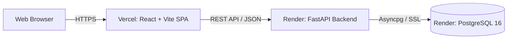

# LedgerLine Production Deployment Guide

This guide walks through deploying LedgerLine to production using **Render** (PostgreSQL & FastAPI Backend) and **Vercel** (React Frontend).

---

## Architecture Overview



---

## 1. Database Deployment (Render PostgreSQL)

1. Log into your [Render Dashboard](https://dashboard.render.com/).
2. Click **New +** &rarr; **PostgreSQL**.
3. Configure the database:
   - **Name:** `ledgerline-db`
   - **Database:** `ledgerline_db`
   - **User:** `ledger_user`
   - **Region:** Singapore / Frankfurt / Oregon (choose closest to your users)
   - **PostgreSQL Version:** 16
   - **Instance Type:** Free
4. Click **Create Database**.
5. Once provisioned, copy the **Internal Database URL** (for backend running on Render) and **External Database URL** (for local migrations if needed).

---

## 2. Backend Deployment (Render Web Service)

1. In Render Dashboard, click **New +** &rarr; **Web Service**.
2. Connect your GitHub repository: `https://github.com/prudhvi5273/ledgerline`.
3. Configure Web Service settings:
   - **Name:** `ledgerline-backend`
   - **Region:** Same region as your database.
   - **Root Directory:** `backend`
   - **Runtime:** `Python 3`
   - **Build Command:**
     ```bash
     pip install -r requirements.txt && alembic upgrade head
     ```
   - **Start Command:**
     ```bash
     uvicorn app.main:app --host 0.0.0.0 --port $PORT
     ```
   - **Instance Type:** Free

4. Configure **Environment Variables** in Render:
   | Key | Value / Description |
   |---|---|
   | `ENVIRONMENT` | `production` |
   | `DEBUG` | `False` |
   | `DATABASE_URL` | `postgresql+asyncpg://<user>:<password>@<internal-host>/ledgerline_db` |
   | `SYNC_DATABASE_URL` | `postgresql+psycopg://<user>:<password>@<internal-host>/ledgerline_db` |
   | `JWT_SECRET_KEY` | Generate with `openssl rand -hex 32` |
   | `CORS_ORIGINS` | `https://ledgerline.vercel.app,http://localhost:5173` |

5. Click **Create Web Service**.
6. When deployment finishes, test the live health check:  
   👉 `https://ledgerline-backend.onrender.com/health`  
   Expected JSON response:
   ```json
   {
     "status": "UP",
     "app": "LedgerLine",
     "version": "1.0.0",
     "database": "HEALTHY"
   }
   ```

---

## 3. Frontend Deployment (Vercel)

1. Log into your [Vercel Dashboard](https://vercel.com/).
2. Click **Add New...** &rarr; **Project**.
3. Import your GitHub repository: `prudhvi5273/ledgerline`.
4. Configure Project settings:
   - **Framework Preset:** `Vite`
   - **Root Directory:** `frontend`
   - **Build Command:** `npm run build`
   - **Output Directory:** `dist`
   - **Install Command:** `npm install`
5. Configure **Environment Variables** in Vercel:
   | Key | Value |
   |---|---|
   | `VITE_API_BASE_URL` | `https://ledgerline-backend.onrender.com/api/v1` |
6. Click **Deploy**.

---

## 4. Post-Deployment Verification Checklist

Once both services are deployed, verify in a private/incognito window:

- [ ] **1. Public Health Check:** Open `/health` on the backend URL. Assert `database: "HEALTHY"`.
- [ ] **2. Client Login:** Sign in with `client.alice@example.com` / `SecretPassword123!`.
- [ ] **3. Account Creation:** Open an account in USD or INR.
- [ ] **4. Deposit Funds:** Deposit ₹5,000. Verify balance updates instantly.
- [ ] **5. Idempotent Transfer:** Transfer ₹1,000 to another account. Click submit twice or check network to verify only one transaction executes.
- [ ] **6. Overdraft Prevention:** Attempt to withdraw more than available balance. Assert refusal.
- [ ] **7. Auditor Role:** Sign in with `auditor.check@example.com` / `AuditorPass123!`. Open Auditor Portal and verify that total debits equal total credits with ₹0.0000 discrepancy.
- [ ] **8. Admin Role:** Sign in with `admin.root@example.com` / `AdminMasterPass123!`. Verify freeze and unfreeze toggles.
